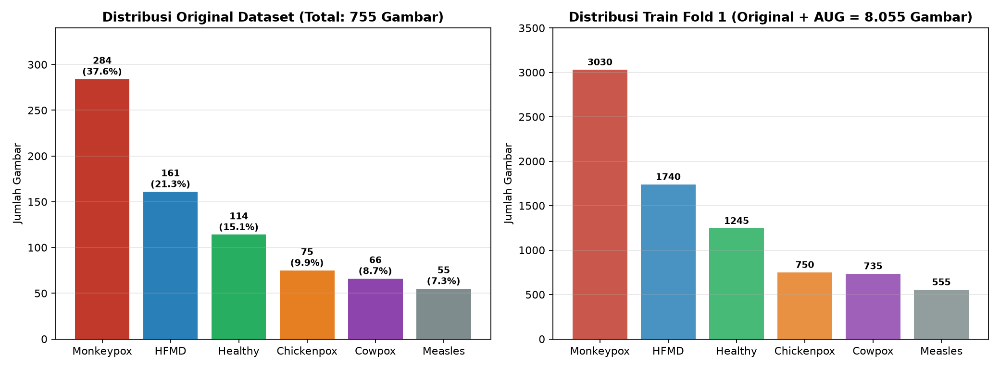
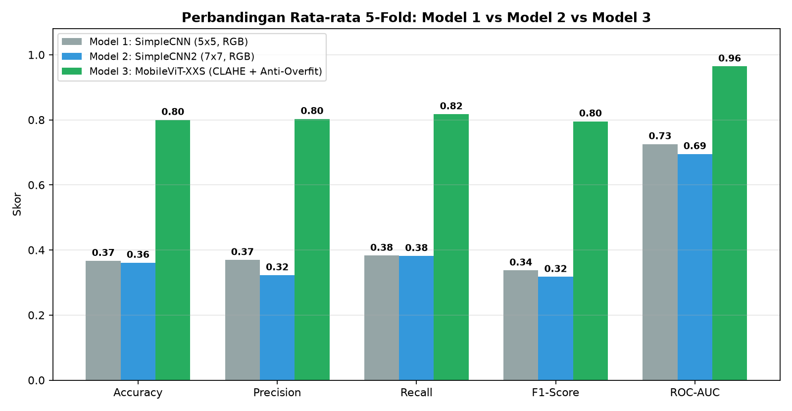
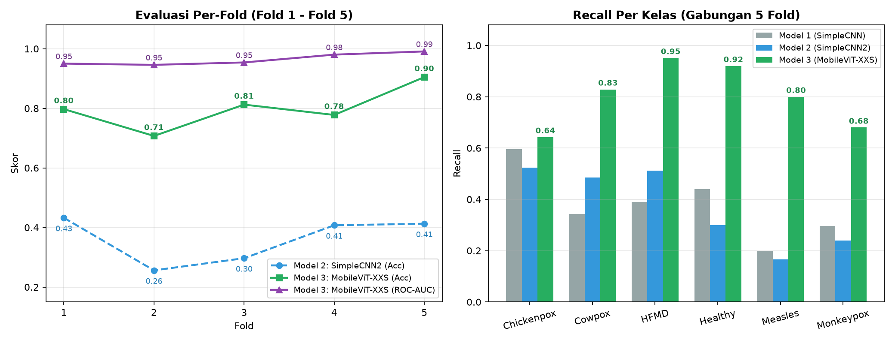
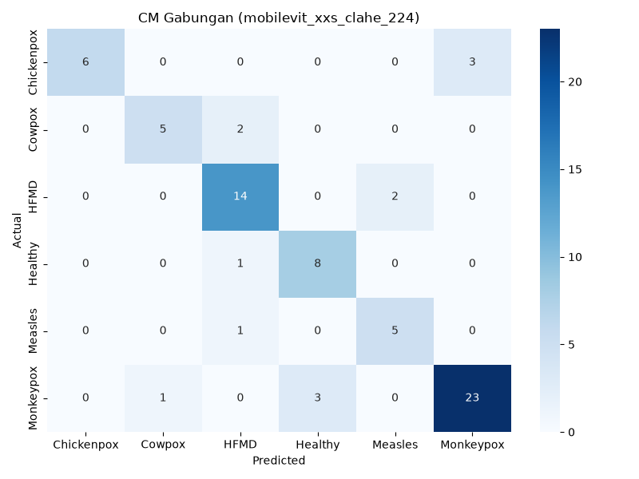
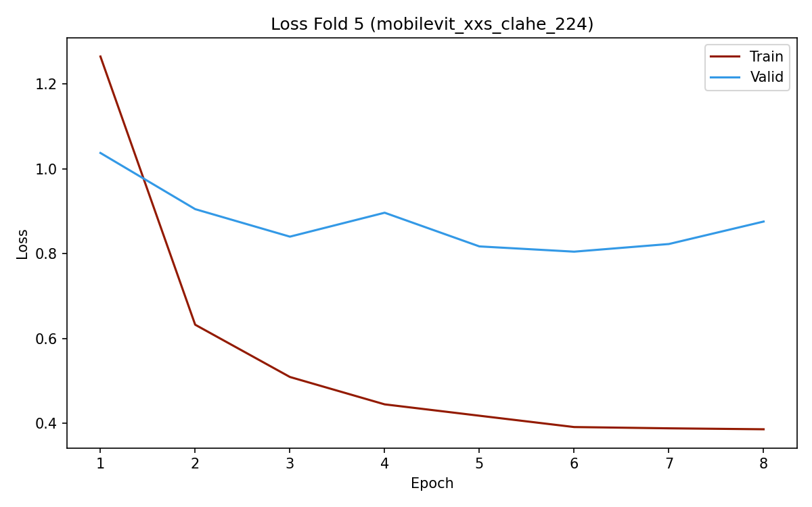

<div align="center">

# Klasifikasi Lesi Kulit Mpox (MSLD v2.0)

**Perbandingan 3 model *deep learning* (`SimpleCNN`, `SimpleCNN2`, dan `MobileViT-XXS`) dengan *5-Fold Cross-Validation* pada dataset *Mpox Skin Lesion Dataset v2.0*.**


</div>

---

## Ringkasan Dataset

Penelitian ini menggunakan [**Mpox Skin Lesion Dataset Version 2.0 (MSLD v2.0)**](https://www.kaggle.com/datasets/joydippaul/mpox-skin-lesion-dataset-version-20-msld-v20) yang terdiri dari **755 citra asli (541 pasien)** dalam **6 kelas**:
`Chickenpox` (75), `Cowpox` (66), `HFMD` (161), `Healthy` (114), `Measles` (55), dan `Monkeypox` (284).

* **Training:** Menggunakan gabungan `Original Train` + `Augmented Train` (`FOLDS_AUG`, ~8.055 gambar per fold).
* **Validation & Testing:** Menggunakan `Original Valid` dan `Original Test` murni (tanpa augmentasi agar bebas *data leakage*).



---

## Arsitektur 3 Model yang Dibandingkan

| Model | File | Arsitektur & Preprocessing | Optimizer & Epoch |
| :--- | :--- | :--- | :--- |
| **Model 1 (`cnn1`)** | `Models/CNN.py` | `SimpleCNN`: 2 blok `Conv(5×5) + ReLU + MaxPool(3×3)` → `Linear`, input `100×100` (`RGB`) | `Adam` (`lr=1e-3`), `NLLLoss`, 20/100 ep |
| **Model 2 (`cnn2`)** | `Models/CNN2.py` | `SimpleCNN2`: 2 blok `Conv(7×7) + ReLU + MaxPool(3×3)` → `Linear`, input `100×100` (`RGB`) | `Adam` (`lr=1e-3`), `NLLLoss`, 20 ep |
| **Model 3 (`mobilevit_xxs`)** | `Models/Model3.py` | `MobileViT-XXS` *pretrained* (Hybrid CNN + Transformer) + `CLAHE (LAB)` + *Aug on-the-fly + Dropout (0.2/0.1) + Mixup*, input `224×224` | `AdamW` (`lr=1e-4`), `CosineAnnealingLR`, 10 ep, `Flip TTA` |

---

## Cara Menjalankan

1. Clone repositori dan install dependensi:
```bash
git clone https://github.com/hafizhsutanto-here/mpox-classification.git
cd mpox-classification
pip install -r requirements.txt
```

2. Cek & unduh dataset otomatis via `kagglehub`:
```bash
python cek_data.py
```

3. Jalankan pelatihan dan pengujian 5-fold (otomatis mendeteksi GPU CUDA jika tersedia, atau CPU):
```bash
# Model 3 (Default: MobileViT-XXS + CLAHE)
python train.py
python test.py

# Model 1 atau Model 2
python train.py --arch cnn1
python test.py --arch cnn1

python train.py --arch cnn2
python test.py --arch cnn2
```

---

## Struktur Proyek

```text
mpox-classification/
├── Models/
│   ├── CNN.py                 # Model 1: SimpleCNN (baseline materi)
│   ├── CNN2.py                # Model 2: SimpleCNN2 (modifikasi kernel 7x7)
│   └── Model3.py              # Model 3: MobileViT-XXS (timm)
├── Utils/
│   ├── getData.py             # Dataset loader 6 kelas, 5-fold, RGB/Gray/CLAHE/Mask
│   └── metrics.py             # Perhitungan metrik & visualisasi grafik
├── results/
│   ├── cnn2_rgb_100/          # Hasil 5-fold Model 2
│   ├── mobilevit_xxs_clahe_224/ # Hasil 5-fold Model 3
│   └── summary/               # Grafik perbandingan untuk laporan & PPT
├── cek_data.py                # Verifikasi unduhan & jumlah data Fold 1
├── train.py                   # Pipeline training 5-fold
├── test.py                    # Pipeline evaluasi 5-fold + ekspor ZIP
├── requirements.txt
└── .gitignore                 # Mengecualikan Dataset/, checkpoints/, *.pt, *.zip
```

---

## Hasil Evaluasi 5-Fold Cross-Validation

### Rata-rata 5-Fold (`mean ± std`)

| Model | Accuracy | Precision | Recall | F1-Score | ROC-AUC |
| :--- | :---: | :---: | :---: | :---: | :---: |
| **Model 1 (`SimpleCNN`)** | `0.3668 ± 0.0356` | `0.3694 ± 0.0586` | `0.3826 ± 0.0589` | `0.3373 ± 0.0326` | `0.7255 ± 0.0163` |
| **Model 2 (`SimpleCNN2`)** | `0.3611 ± 0.0791` | `0.3226 ± 0.0648` | `0.3818 ± 0.0526` | `0.3175 ± 0.0688` | `0.6949 ± 0.0319` |
| **Model 3 (`MobileViT-XXS + CLAHE`)** | **`0.7999 ± 0.0711`** | **`0.8028 ± 0.0983`** | **`0.8175 ± 0.0426`** | **`0.7954 ± 0.0762`** | **`0.9643 ± 0.0201`** |



### Hasil Per-Fold & Recall Per Kelas



| Fold | Model 2 Accuracy | Model 2 ROC-AUC | Model 3 Accuracy | Model 3 F1-Score | Model 3 ROC-AUC |
| :---: | :---: | :---: | :---: | :---: | :---: |
| **Fold 1** | 0.4324 | 0.7224 | 0.7973 | 0.8013 | 0.9501 |
| **Fold 2** | 0.2561 | 0.6540 | 0.7073 | 0.6842 | 0.9460 |
| **Fold 3** | 0.2969 | 0.6650 | 0.8125 | 0.8059 | 0.9541 |
| **Fold 4** | 0.4074 | 0.7155 | 0.7778 | 0.7871 | 0.9803 |
| **Fold 5** | 0.4127 | 0.7176 | **0.9048** | **0.8985** | **0.9910** |

### Visualisasi Confusion Matrix & Kurva Loss (Model 3)

| Confusion Matrix Gabungan (5-Fold) | Contoh Kurva Loss (Fold 5) |
| :---: | :---: |
|  |  |
